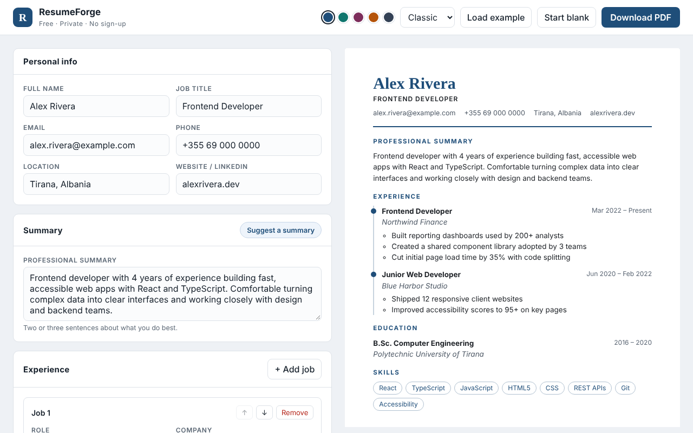

# ResumeForge

Resume builder with live preview, an experience timeline and one-click PDF export.



**Live demo:** _add your Vercel link here after deploying_

## Features

- **Live preview**: the resume updates as you type, laid out at A4 proportions.
- **Experience timeline**: add, remove and reorder jobs; one achievement per line becomes a bullet.
- **Suggested summary**: one click builds a starting summary from your job title, years of experience and top skills, ready to edit.
- **Two templates and five accent colors**.
- **One-click PDF**: a print stylesheet hides the editor and prints only the resume on A4.
- **Saved automatically** in `localStorage`, so nothing is lost on reload. No account or server.
- **Responsive**: on phones the editor and preview switch with tabs.

## Tech stack

- [React 18](https://react.dev) with function components and hooks
- [TypeScript](https://www.typescriptlang.org) in strict mode
- [Vite](https://vitejs.dev) for development and builds
- Plain CSS with custom properties (no UI framework)
- No backend: everything runs in the browser

## Getting started

You need [Node.js](https://nodejs.org) 18 or newer.

```bash
git clone https://github.com/eraldashehu/resume-builder.git
cd resume-builder
npm install
npm run dev
```

Then open http://localhost:5173.

```bash
npm run typecheck # check types with tsc
npm run build     # type-check, then production build in dist/
npm run preview   # serve the build locally
```

## Project structure

```
src/
├── App.tsx                 # layout, toolbar, templates and colors
├── components/
│   ├── Editor.tsx          # form sections and list editing
│   ├── Field.tsx           # labelled input / textarea
│   └── Preview.tsx         # the printable resume sheet
├── hooks/useLocalStorage.ts
├── lib/
│   ├── summary.ts          # suggested summary from title, years, skills
│   └── format.ts           # date ranges, years of experience
├── data/sample.ts          # example resume
└── types.ts                # Resume, Experience, Education types
```

## What I focused on

- Typing nested form updates with generics, so each field only accepts the right value type.
- Calculating years of experience from month ranges, including current jobs.
- Immutable updates for nested lists (add, edit, reorder, remove).
- Print CSS with `@page` to turn a web page into a clean PDF without a library.

## Deploy

**GitHub Pages (automatic):** this repository includes `.github/workflows/deploy.yml`. In the repository go to **Settings → Pages**, set **Source** to **GitHub Actions**, then push. The app is published at `https://eraldashehu.github.io/resume-builder/`.

**GitLab Pages (automatic):** this repository includes `.gitlab-ci.yml`. Push it to GitLab and the app is built and published on every push. The live address appears under **Deploy → Pages**.

**Vercel:**

1. Push this repository to GitHub.
2. Go to [vercel.com](https://vercel.com), choose **Add New → Project** and import the repository.
3. Vercel detects Vite automatically. Click **Deploy**.

Using GitLab instead of GitHub? Vercel imports GitLab projects the same way: choose **Continue with GitLab** when you sign in.

## Author

**Eralda Shehu**, Frontend Developer
[LinkedIn](https://www.linkedin.com/in/eralda-shehu/) · [GitHub](https://github.com/eraldashehu)
